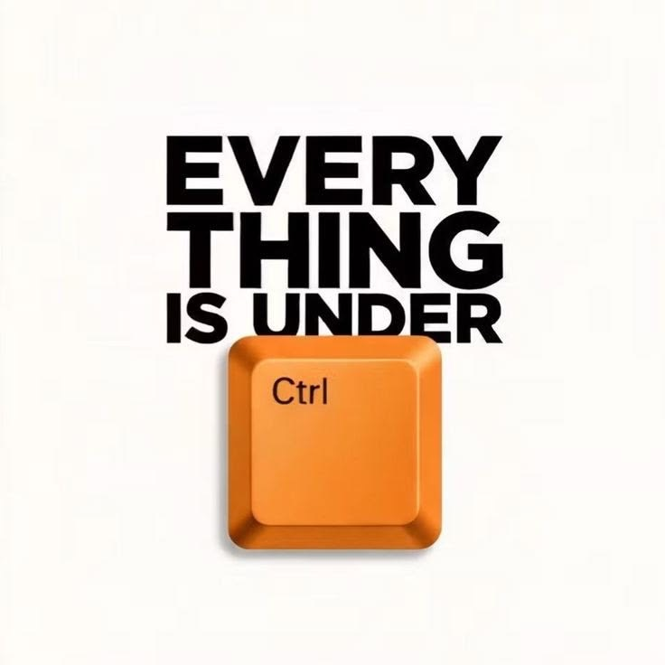

<!-- Soft Sage Top Wave -->

<!-- HEADER WITH SIDE-BY-SIDE PICTURE & TYPING BANNER -->
<table>
<tr>
<td align="center" valign="middle">

</td>
<td align="center" valign="middle">
<td align="center" valign="middle">

</td>
</tr>
</table>

<code> "with love always." 🪷</code>

 
<!-- ABOUT ME SECTION -->
<!-- ABOUT ME SECTION -->

 
<h2>Welcome to my space 🍀</h2>

  𝐇𝐞𝐥𝐥𝐨! 𝐈'𝐦 𝐊𝐚𝐭𝐞 𝐋𝐞𝐲𝐡𝐚𝐧 𝐋𝐮𝐦𝐛𝐨𝐲, 𝑖𝑛𝑡𝑟𝑜𝑣𝑒𝑟𝑡𝑒𝑑, 𝑦𝑒𝑡 𝑎𝑙𝑤𝑎𝑦𝑠 𝑟𝑒𝑎𝑑𝑦 𝑓𝑜𝑟 𝑓𝑢𝑛 𝑎𝑛𝑑 𝑎𝑑𝑣𝑒𝑛𝑡𝑢𝑟𝑒.
  𝐼 𝑒𝑛𝑗𝑜𝑦 𝑔𝑜𝑖𝑛𝑔 𝑜𝑢𝑡, 𝑒𝑠𝑝𝑒𝑐𝑖𝑎𝑙𝑙𝑦 𝑡𝑜 𝑐𝑜𝑓𝑓𝑒𝑒 𝑠ℎ𝑜𝑝𝑠. 𝐴 𝑓𝑢𝑛 𝑓𝑎𝑐𝑡 𝑎𝑏𝑜𝑢𝑡 𝑚𝑒 𝑖𝑠 𝑡ℎ𝑎𝑡 𝐼 𝑐𝑎𝑛 𝑤𝑜𝑟𝑘 𝑤𝑒𝑙𝑙 𝑏𝑜𝑡ℎ 𝑜𝑛 𝑚𝑦 𝑜𝑤𝑛 𝑎𝑛𝑑 𝑤𝑖𝑡ℎ 𝑜𝑡ℎ𝑒𝑟𝑠.
  𝐼'𝑚 𝑎 𝑓𝑖𝑟𝑠𝑡-𝑦𝑒𝑎𝑟 𝐼𝑇 𝑠𝑡𝑢𝑑𝑒𝑛𝑡, 𝑠𝑡𝑖𝑙𝑙 𝑙𝑒𝑎𝑟𝑛𝑖𝑛𝑔 𝑎𝑛𝑑 𝑐𝑜𝑛𝑡𝑖𝑛𝑢𝑜𝑢𝑠𝑙𝑦 𝑖𝑚𝑝𝑟𝑜𝑣𝑖𝑛𝑔 𝑚𝑦 𝑐𝑜𝑑𝑖𝑛𝑔 𝑠𝑘𝑖𝗅𝗅𝑠, 𝑡𝑎𝑘𝑖𝑛𝑔 𝑡ℎ𝑖𝑛𝑔𝑠 𝑜𝑛𝑒 𝑠𝑡𝑒𝑝 𝑎𝑡 𝑎 𝑡𝑖𝑚𝑒 𝑎𝑠 𝐼 𝑓𝑖𝑔𝑢𝑟𝑒 𝑜𝑢𝑡 𝑤ℎ𝑎𝑡 𝐼 𝑒𝑛𝑗𝑜𝑦 𝑎𝑛𝑑 𝑏𝑢𝑖𝑙𝑑 𝑏𝑒𝑡𝑡𝑒𝑟 ℎ𝑎𝑏𝑖𝑡𝑠 𝑎𝑙𝑜𝑛𝑔 𝑡ℎ𝑒 𝑤𝑎𝑦.

<i> Any Progress Is Progress. 🐌</i>
  
<!-- Beige Line -->

  
<!-- PROGRAMMING LANGUAGES SECTION -->

  

 
<!-- Sage Green Line -->

  
<!-- MY PROJECTS SECTION -->

 
<table>
<tr>
<td width="50%" valign="top">

🌷 <a href="midterms/Laboratory task 2D - Lumboy, Kate Leyhan C. - ITE104.pdf">Midterm Lab Task #1</a> - Midterm Lab Task 1. Using 2 Dimensional Array  
🌷 <a href="#link">Midterm Lab Task #2</a> - Midterm Lab Task 2. Using 3 Dimensional Array  
🌷 <a href="#link">Midterm Lab Task #3</a> -   
🌷 <a href="#link">Midterm Lab Task #4</a> -   
🌷 <a href="#link">Midterm Lab Task #5</a> -

</td>
<td width="50%" valign="top">

🪷 <a href="#link">Final Lab Task #1</a> -   
🪷 <a href="#link">Final Lab Task #2</a> -   
🪷 <a href="#link">Final Lab Task #3</a> -   
🪷 <a href="#link">Final Lab Task #4</a> -   
🪷 <a href="#link">Final Lab Task #5</a> -   
🪷 <a href="#link">Final Lab Task #6</a> -

</td>
</tr>
</table>
 

  

<!-- Soft Sage Bottom Wave -->

